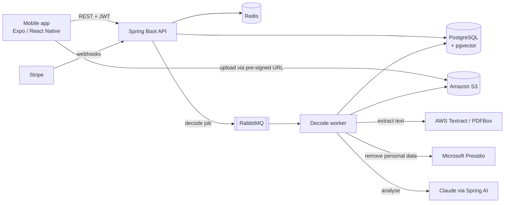

# Opas


**An AI document assistant for expats in Finland.**

Letters from Kela, the tax office and the immigration service are hard to read if you are new to Finland. Opas lets you scan a letter, explains it in plain language, and shows the deadlines and the next steps — in English, Finnish or Swedish.

<!-- Add 2–3 app screenshots here, e.g.:
<p align="center">
  
  
  
</p>
-->

## What it does

- **Scan or upload** a document (photo or PDF)
- **Decode it** — a short summary, key details, deadlines and required actions
- **Draft a reply** or appeal letter in the right language
- **Search** across all your documents by meaning, not just keywords
- **Get reminders** before a deadline passes
- **Organise** documents into folders
- Free and paid plans, with usage limits per plan

## How it works



1. The app uploads the file straight to S3 using a short-lived pre-signed URL, so large files never pass through the API.
2. The API puts a decode job on RabbitMQ and returns right away.
3. A worker downloads the file, extracts the text, and **removes personal data (names, ID numbers, addresses) with Presidio before anything is sent to the AI model**.
4. Claude returns a structured result (summary, deadlines, actions), which is saved to PostgreSQL. An embedding is stored with pgvector for semantic search.
5. A scheduled job checks for upcoming deadlines and sends push notifications.

## Tech stack

| Area | Tools |
|---|---|
| Backend | Java 21, Spring Boot 3.5, Spring Security, Spring Data JPA, Spring AI |
| Data | PostgreSQL 16 + pgvector, Flyway (10 migrations), Redis |
| Messaging | RabbitMQ |
| AI & privacy | Anthropic Claude, Microsoft Presidio for PII removal |
| Payments | Stripe (Checkout, Customer Portal, webhooks) |
| Auth | JWT (RS256), refresh tokens, token blacklist, email verification |
| Mobile | Expo 54, React Native, Expo Router, TanStack Query, Zustand, NativeWind, i18next (en/fi/sv) |
| Cloud | AWS ECS Fargate, ALB, S3, Textract, SES, Secrets Manager — defined in CloudFormation |
| CI/CD | GitHub Actions with AWS OIDC (no stored AWS keys), Docker, Trivy image scanning |
| Observability | Spring Actuator, Micrometer, Prometheus, Grafana |
| Testing | JUnit 5, Mockito, Testcontainers |

## Engineering highlights

- **Privacy first:** personal data is stripped out before any text reaches the AI model.
- **Async processing:** slow work (OCR + AI) runs on RabbitMQ workers, not inside the HTTP request. Redelivered messages are handled safely.
- **Safe payment webhooks:** Stripe events are processed once, using idempotency keys in Redis. If processing fails, the key is released so Stripe's retry can succeed.
- **Rate limiting and quotas** per user and per plan, backed by Redis.
- **Distributed scheduling** with ShedLock, so reminder jobs run once even with several app instances.
- **Infrastructure as code:** separate staging and production stacks in CloudFormation.

## Project structure

```
opas-backend/   Spring Boot API and decode worker
opas-mobile/    Expo / React Native app (iOS + Android)
opas-infra/     Docker Compose for local development + CloudFormation for AWS
```

## API overview

All endpoints are under `/api/v1`. Full docs at `/swagger-ui.html` when running locally.

| Resource | Endpoints |
|---|---|
| Auth | register, verify email, login, refresh, logout, forgot/change password, delete account |
| Documents | get upload URL, confirm upload, list, search, get, archive, move to folder, delete |
| Decode | start decode, get result |
| Draft letter | create, get |
| Folders | create, list, get, update, delete |
| Subscription | plans, usage, checkout, billing portal |
| Webhooks | Stripe |

## Run it locally

Requirements: Java 21, Maven, Docker, Node 20.

```bash
# 1. Start PostgreSQL, Redis, RabbitMQ, Presidio, LocalStack, Prometheus and Grafana
cd opas-infra
docker compose up -d

# 2. Start the backend
cd ../opas-backend
cp .env.example .env.local   # fill in your own keys
./mvnw spring-boot:run -Dspring-boot.run.profiles=local

# 3. Start the mobile app
cd ../opas-mobile
npm install
npx expo start
```

## Tests

```bash
cd opas-backend && mvn verify      # unit + integration tests (Docker must be running)
cd opas-mobile && npm run typecheck && npm run lint
```

## Author

Built by **Salau Oluwole** — [GitHub](https://github.com/GCremez) · [LinkedIn](https://www.linkedin.com/in/salauol)
